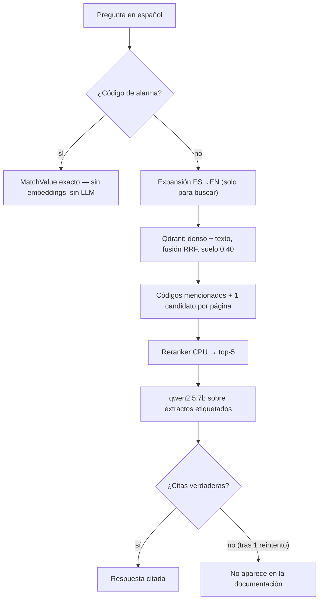

# TrueCopy

**Respuestas citadas de tus manuales — o silencio.** Asistente RAG local para
operarios: preguntas en español sobre manuales de maquinaria en inglés, con
cita a Manual+Página o negativa exacta. Nada sale de la máquina.

> Sin evidencia no hay llamada al modelo. Sin cita válida no hay respuesta.

## El contrato (5 líneas)

1. Pregunta con forma de código de alarma → respuesta exacta, sin LLM.
2. Búsqueda híbrida (denso + texto, RRF) con suelo de relevancia calibrado.
3. Reranker que corta a 5 páginas diversas; el LLM solo transcribe extractos.
4. Cada `[Fuente: … Página N]` se valida contra lo recuperado; si falla, negativa.
5. `No aparece en la documentación` — exacta, sin inventar, sin parciales.

Detalle del mecanismo: [COMO-DECLINE-EL-SISTEMA.md](COMO-DECLINE-EL-SISTEMA.md).

## Arquitectura



Todo local: Qdrant (Docker) + Ollama + BGE-M3 en CPU + Streamlit en LAN.
Mapa completo: [ARQUITECTURA.md](ARQUITECTURA.md).

## Arranque rápido

```powershell
python -m venv .venv
.\.venv\Scripts\python -m pip install -r requirements.txt
# `pip install -e .` NO basta: las dependencias de runtime viven en
# requirements.txt (ADR-002), pyproject solo declara el paquete.
.\.venv\Scripts\python -m pytest tests -q   # 362 tests herméticos, sin servicios

docker compose up -d                          # Qdrant en 127.0.0.1:6333 (solo loopback)
ollama pull qwen2.5:7b-instruct               # LLM en el host (VRAM libre)

# La PRIMERA consulta descarga BGE-M3 (~2 GB) y el reranker desde Hugging
# Face: hace falta internet una vez. Después, todo es offline.

# Indexar TU manual (los PDF no viajan en este repo):
.\.venv\Scripts\python scripts/ingest.py .\documentation\tu-manual.pdf

.\.venv\Scripts\python scripts/query.py "700016"        # alarma conocida
.\.venv\Scripts\python scripts/query.py "presion neumaticos"
.\.venv\Scripts\python scripts/eval.py                   # 4 checks + barrido MIN_SCORE
.\.venv\Scripts\python scripts/run_web.py                # UI en LAN :8501
```

Guía paso a paso con éxitos esperados y troubleshooting:
[TUTORIAL-PUESTA-EN-MARCHA.md](TUTORIAL-PUESTA-EN-MARCHA.md).

## La cadena (una sola, tres puertas)

`answer_question` (`src/plant_rag/answer/pipeline.py`) es el único camino que
ejecutan CLI, web y eval: fastpath → expansión → híbrido RRF → unión de
alarmas mencionadas → diversidad por página → rerank top-5 → LLM con contrato.
Un arreglo aterriza en los tres a la vez.

## Evaluación

`scripts/eval.py` contra la pila viva: alarma conocida/desconocida, ES→EN
cross-lingual, negativas fuera de corpus y **goldens por manual** (páginas
esperadas verificadas a mano; un manual sin goldens falla a propósito en vez
de aprobarse en silencio). Además barre `MIN_SCORE` e informa sin cambiarlo.

## Estructura

```
src/plant_rag/      núcleo: config, models, monitoring
  ingest/           loader, chunker (padre/hijo), alarms, reindex azul/verde
  retrieve/         expand, embedder, hybrid (RRF), rerank, fastpath, store
  answer/           pipeline, prompt, citations, llm
  scheduling/       cola prioritaria con plazo de 45 s
web/                app Streamlit LAN + auth Argon2id + textos ES
scripts/            ingest, reindex, query, run_web, eval
tests/              suite hermética (sin Qdrant ni Ollama)
```

## Operación (resumen)

- Servicios: Qdrant Docker + Ollama en host; todo `PLANT_RAG_*` por entorno.
- Qdrant publica 6333/6334 solo en `127.0.0.1`: no trae autenticación, así que
  exponerlo en la LAN daría acceso total al corpus saltándose el login de la
  app. La app (Streamlit) es la única puerta para el operario.
- Primer arranque: la app crea el propietario `admin` con una **contraseña
  aleatoria impresa una sola vez en la consola del servidor** (no hay
  credencial fija en el código): cópiala y cámbiala en Owner > Códigos;
  `users.json` gitignored, jamás commitear.
- Owner: subir PDF (UUID), reindexar vía CLI, gestionar códigos.
- Rollback por paquetes o reset total (`down -v` + borrar datos; el núcleo intacto).

## Acceso LAN y regla de firewall (ADR-006)

La app escucha en `0.0.0.0:8501` para llegar a la LAN; la regla de firewall
es la frontera que la mantiene alcanzable only from the LAN subnet:

```bash
# Ejemplo iptables (subred del operador): aceptar la subred, tirar el resto.
sudo iptables -A INPUT -p tcp --dport 8501 -s 192.0.2.0/24 -j ACCEPT
sudo iptables -A INPUT -p tcp --dport 8501 -j DROP
```

```powershell
# Ejemplo Windows Defender (PowerShell, admin):
New-NetFirewallRule -DisplayName "TrueCopy Streamlit LAN" `
  -Direction Inbound -Protocol TCP -LocalPort 8501 `
  -Action Allow -RemoteAddress 192.0.2.0/24  # ejemplo: pon tu subred LAN
```

## Convenciones

- Código y comentarios en inglés; UI/errores en español; extractos del manual
  en su inglés original.
- Tests herméticos; commits convencionales; todo ajuste por `PLANT_RAG_*`.
- Local-only: ningún documento sale de la máquina. Trae tu propio PDF.
